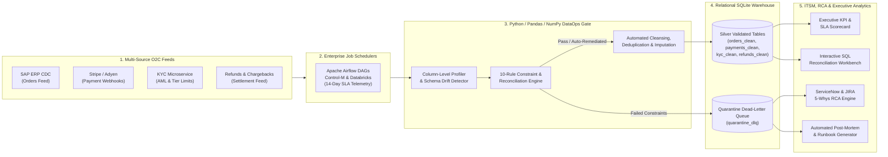

# 🛡️ DataOps Sentinel — Enterprise ETL Observability, Data Quality & Incident RCA Platform

[](https://www.python.org/)
[](https://streamlit.io/)
[](https://pandas.pydata.org/)
[](https://www.servicenow.com/)
[](#7-local-setup-cli-execution--testing)

**Author:** [Ankur Bhatt](https://www.linkedin.com/in/iankurbhatt) — Senior Analyst, Data Operations & Analytics  
📧 [iankurbhatt1@gmail.com](mailto:iankurbhatt1@gmail.com) | 🔗 [LinkedIn](https://www.linkedin.com/in/iankurbhatt)

---

## 📖 Overview

In high-volume **Order-to-Cash (O2C)** environments, operational data feeds ingested from ERP (`SAP_ERP_CDC`), CRM (`Salesforce CPQ`), E-Commerce (`Shopify Plus`), Payment Gateways (`Stripe`, `Adyen`, `Razorpay`, `JPM Wire`), and KYC/AML microservices are prone to upstream data anomalies that silently corrupt financial ledgers and executive BI reporting:

* **Webhook Retry Storms:** Gateway HTTP timeouts trigger exponential POST retries, introducing duplicate primary keys (`order_id`, `payment_id`) and inflating Gross Merchandise Value (GMV).
* **Asynchronous CDC Replication Lag:** Streaming payment captures land ahead of batch ERP order syncs, creating orphan foreign-key references and breaking daily cash-to-order reconciliation.
* **Upstream Schema Drift:** Unannounced producer payload changes drop mandatory fields (`customer_id`, `merchant_region`) or introduce invalid currency codes and malformed timestamps.
* **Compliance & Revenue Leakage:** Stale KYC cache syncs allow `UNVERIFIED` or `EXPIRED` accounts to transact above tier limits, while uncapped refund endpoints permit over-refund disbursements (`refund_amount_usd > captured_amount_usd`).

**DataOps Sentinel** is an end-to-end **Data Operations, Pipeline Observability, SQL Reconciliation, and Incident Root Cause Analysis (RCA)** platform. It sits between raw Bronze ingestion and Silver/Gold production tables to profile incoming feeds, enforce 10 declarative validation rules, isolate bad records in a Dead-Letter Queue (`quarantine_dlq`), and automate ServiceNow/JIRA incident triage.

---

## 🏗️ System Architecture & Dataflow



---

## 🛠️ Technical Stack & Core Capabilities

| Layer | Technologies & Methods | Implementation Details |
| :--- | :--- | :--- |
| **Data Processing & ETL** | `Python 3.10+`, `Pandas`, `NumPy` | Vectorized column profiling, primary-key deduplication, missing-value imputation, currency/timestamp normalization, and IQR outlier detection ([`src/etl_validator.py`](src/etl_validator.py)). |
| **Relational Warehouse & SQL** | `SQLite3`, `SQL (CTEs, Window Functions)` | In-memory operational warehouse hosting Bronze and Silver tables with 8 reconciliation and audit queries ([`src/sql_workbench.py`](src/sql_workbench.py)). |
| **ITSM & Incident RCA** | `ServiceNow (INC)`, `JIRA (DOPS)`, `5-Whys Methodology` | Automated anomaly-to-ticket correlation, P1–P3 severity scoring, MTTR/SLA tracking, upstream lineage mapping, and SQL/Airflow remediation patches ([`src/incident_rca.py`](src/incident_rca.py)). |
| **Observability & KPIs** | `Streamlit`, `Plotly` | Interactive dark-mode command center tracking Data Quality Health Score, Revenue Protected, Quarantine Rate, and 14-day scheduler SLA latency ([`app.py`](app.py)). |
| **Runbook & Report Automation** | `Automated Markdown Synthesis` | 1-click generation of Confluence incident post-mortems, JIRA engineering defect specs, and executive commercial risk briefs ([`src/genai_copilot.py`](src/genai_copilot.py)). |
| **Batch CLI & Orchestration** | `Bash`, `argparse`, `Jupyter` | Headless batch runner for Airflow/Control-M/Cron execution ([`scripts/run_etl_pipeline.sh`](scripts/run_etl_pipeline.sh)) and interactive notebook analysis ([`notebooks/DataOps_Profiling_and_RCA.ipynb`](notebooks/DataOps_Profiling_and_RCA.ipynb)). |

---

## 🖥️ Platform Modules

### 1. Executive KPI & Pipeline Command Center
* Tracks 6 headline operational metrics: **Data Quality Score (%)**, **Total Constraint Checks**, **Quarantined Records (DLQ)**, **Revenue Protected ($ USD)**, **Active ITSM Incidents**, and **Mean Time to Resolution (MTTR)**.
* Visualizes commercial revenue exposure by rule, 14-day scheduler duration spikes across `Apache Airflow`, `Control-M Enterprise`, and `Databricks Workflows`, regional Silver-layer order volume, and anomaly distribution by data quality dimension.

### 2. ETL Profiling, Validation & Quarantine Engine
* Evaluates 10 production validation rules across `orders_raw`, `payments_raw`, `customer_kyc_raw`, and `refunds_raw`.
* Provides an interactive **Column-Level Data Profiler** (null %, cardinality, data types, min/mean/max, negative counts) to compare Bronze staging tables against cleansed Silver tables.
* Includes a filterable **Dead-Letter Queue (`quarantine_dlq`)** inspector with CSV export.

### 3. Interactive SQL Reconciliation Workbench
* Executes live SQL queries against the relational warehouse. Includes 8 pre-configured operational queries:
  1. *Order-to-Payment Ledger Reconciliation (Variance > $0.05)*
  2. *Orphan Payment Captures (CDC Replication Lag Audit)*
  3. *Webhook Retry Storm & Duplicate PK Detection (`ROW_NUMBER()` Window Function)*
  4. *High-Value AML/KYC Compliance Breach Audit*
  5. *Over-Refund Revenue Leakage Detection*
  6. *Payment Gateway Settlement SLA Breach Summary*
  7. *Enterprise Scheduler Pipeline Reliability & Quarantine KPI*
  8. *Bronze vs. Silver Layer Cleansing Impact Reconciliation*
* Supports custom ad-hoc SQL queries with read-only guardrails and CSV result export.

### 4. ServiceNow / JIRA Incident Tracker & 5-Whys RCA Engine
* Automatically maps validation rule failures to **ServiceNow (`INC0084910`–`INC0084935`)** and **JIRA (`DOPS-1401`–`DOPS-1424`)** tickets.
* Displays end-to-end operational lineage (`Upstream Source` ➔ `Scheduler DAG` ➔ `Validation Gate` ➔ `Downstream Consumer`), structured **5-Whys Root Cause Analysis**, immediate containment steps, and permanent SQL/Airflow remediation patches.

### 5. Automated Runbooks & Stakeholder Documentation
* Generates downloadable Markdown artifacts from live pipeline telemetry:
  * **Incident Post-Mortem & RCA Report**
  * **JIRA Engineering Escalation & Patch Specification**
  * **Executive Commercial & Risk Stakeholder Brief**
* Includes an interactive query assistant for quick operational status checks.

### 6. Custom CSV Audit & Cleansing Utility
* Accepts any raw `.csv` file upload to perform automated column profiling, exact duplicate removal, whitespace trimming, median/categorical imputation, and 3x IQR outlier flagging, outputting a cleansed CSV.

---

## 🛡️ Declarative Validation Rules (`RULE-01` – `RULE-10`)

| Rule ID | Rule Name | Dimension | Target Feed | Severity | Automated Remediation Action |
| :--- | :--- | :--- | :--- | :--- | :--- |
| **`RULE-01`** | Order PK Uniqueness Check | `Uniqueness` | `orders_raw` | `CRITICAL` | Deduplicate on `order_id` retaining earliest ingestion timestamp. |
| **`RULE-02`** | Mandatory Customer & Region Completeness | `Completeness` | `orders_raw` | `HIGH` | Impute `merchant_region` via lookup; quarantine missing `customer_id`. |
| **`RULE-03`** | Positive Order Total & Discount Ceiling | `Validity` | `orders_raw` | `CRITICAL` | Quarantine negative order totals or rows where `discount_usd > order_amount_usd`. |
| **`RULE-04`** | ISO Currency & Temporal Boundary Check | `Schema & Drift` | `orders_raw` | `MEDIUM` | Normalize unsupported currency codes to `USD` fallback & clamp future timestamps. |
| **`RULE-05`** | Payment Webhook Idempotency Check | `Uniqueness` | `payments_raw` | `HIGH` | Drop duplicate webhook retry captures on `payment_id`. |
| **`RULE-06`** | Order-to-Payment Referential Integrity | `Referential Integrity` | `payments_raw` | `CRITICAL` | Route orphan payments (`order_id` missing in `orders_raw`) to 15-min CDC Holding Queue. |
| **`RULE-07`** | Order vs. Captured Payment Reconciliation | `Accuracy` | `payments_raw` | `HIGH` | Flag variance `> $0.05` between `captured_amount_usd` and `net_order_total_usd` for FinOps. |
| **`RULE-08`** | Gateway Settlement SLA Threshold Check | `Timeliness` | `payments_raw` | `MEDIUM` | Log gateway SLA breaches (`actual_settlement_hours > settlement_sla_hours`). |
| **`RULE-09`** | AML/KYC Tier Limit & Verification Constraint | `Compliance` | `customer_kyc_raw` | `CRITICAL` | Place `COMPLIANCE_HOLD` on `UNVERIFIED`/`EXPIRED` KYC accounts exceeding tier limits. |
| **`RULE-10`** | Refund Ceiling vs. Captured Payment Constraint | `Validity` | `refunds_raw` | `CRITICAL` | Cap refund disbursement at 100% of captured payment & escalate excess leakage. |

---

## 📂 Repository Structure

```text
enterprise-dataops-command-center/
├── .streamlit/
│   └── config.toml                        # Streamlit dark theme & server settings
├── notebooks/
│   └── DataOps_Profiling_and_RCA.ipynb    # Interactive Jupyter Notebook walkthrough
├── scripts/
│   ├── cli_runner.py                      # Headless batch ETL & validation CLI runner
│   └── run_etl_pipeline.sh                # Bash wrapper for Airflow / Control-M / Cron
├── src/
│   ├── __init__.py
│   ├── data_generator.py                  # Multi-table Order-to-Cash feed simulator
│   ├── etl_validator.py                   # Column profiler, 10-rule validator & cleanser
│   ├── sql_workbench.py                   # SQLite warehouse builder & 8 audit SQL queries
│   ├── incident_rca.py                    # ServiceNow/JIRA incident tracker & 5-Whys RCA
│   └── genai_copilot.py                   # Automated Post-Mortem, JIRA spec & brief generator
├── tests/
│   └── test_pipeline.py                   # End-to-end integration test suite
├── .gitignore
├── app.py                                 # Main Streamlit application entry point
├── requirements.txt                       # Python dependencies
└── README.md
```

---

## 🚀 Local Setup, CLI Execution & Testing

### 1. Clone & Install Dependencies
```bash
git clone https://github.com/iankurbhatt/enterprise-dataops-command-center.git
cd enterprise-dataops-command-center
pip install -r requirements.txt
```

### 2. Launch the Streamlit Application
```bash
streamlit run app.py
# Or:
python -m streamlit run app.py
```

### 3. Run the Headless Batch CLI Pipeline
```bash
bash scripts/run_etl_pipeline.sh 1200 "P1 Incident: Payment Webhook Retry Storm"
```
Exports `quarantine_dlq.csv`, `servicenow_incidents.csv`, and `validation_rule_results.csv` to `data/exports/`.

### 4. Run Automated Tests
```bash
python tests/test_pipeline.py
```

---

## 📬 Contact
**Ankur Bhatt**  
📧 [iankurbhatt1@gmail.com](mailto:iankurbhatt1@gmail.com) | 🔗 [LinkedIn](https://www.linkedin.com/in/iankurbhatt)
