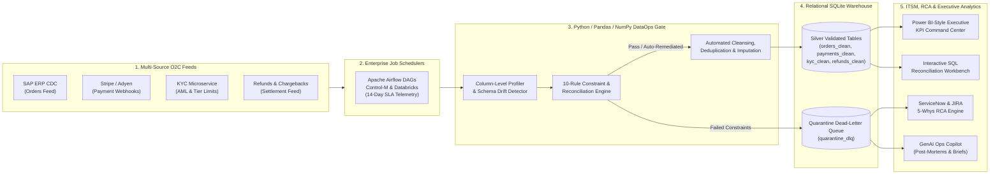

# 🛡️ DataOps Sentinel — Enterprise ETL Observability, Data Quality & Incident RCA Command Center

[](https://www.python.org/)
[](https://streamlit.io/)
[](https://pandas.pydata.org/)
[](https://www.servicenow.com/)
[](#8-automated-testing--headless-cli-execution)

> **Portfolio Project by [Ankur Bhatt](https://www.linkedin.com/in/iankurbhatt)**  
> **Role:** Senior Analyst — Data Operations & Analytics *(4+ Years IT Experience | 3+ Years Specializing in Data Operations, ETL/ELT Pipelines, Data Cleansing, SQL Reconciliation & Root Cause Analysis)*  
> 📍 **Location:** New Delhi, India | 📧 **Email:** [iankurbhatt1@gmail.com](mailto:iankurbhatt1@gmail.com) | 🔗 **LinkedIn:** [linkedin.com/in/iankurbhatt](https://www.linkedin.com/in/iankurbhatt)

---

## 📖 Table of Contents
1. [Executive Summary & Business Problem](#1-executive-summary--business-problem)
2. [System Architecture & Dataflow](#2-system-architecture--dataflow)
3. [Resume Skills Mapped to Codebase](#3-resume-skills-mapped-to-codebase)
4. [Deep-Dive: The 6 Interactive Command Center Modules](#4-deep-dive-the-6-interactive-command-center-modules)
5. [The 10 Declarative Data Quality & Constraint Rules](#5-the-10-declarative-data-quality--constraint-rules)
6. [The 4 Simulated Production Incident Scenarios](#6-the-4-simulated-production-incident-scenarios)
7. [Repository Structure](#7-repository-structure)
8. [Quickstart, Bash CLI & Automated Testing](#8-quickstart-bash-cli--automated-testing)
9. [Deploying to Streamlit Community Cloud](#9-deploying-to-streamlit-community-cloud)
10. [STAR-Method Interview Walkthrough & Case Study Narrative](#10-star-method-interview-walkthrough--case-study-narrative)

---

## 1. Executive Summary & Business Problem

In enterprise **Order-to-Cash (O2C)** and FinTech ecosystems, data flows continuously across heterogeneous systems—**ERP (`SAP_ERP_CDC`)**, **CRM (`Salesforce CPQ`)**, **E-Commerce (`Shopify Plus`)**, **Payment Gateways (`Stripe`, `Adyen`, `Razorpay`, `JPM Wire`)**, and **KYC/AML Compliance Microservices**.

Without a rigorous **Data Operations (DataOps) Firewall**, upstream production anomalies silently corrupt downstream **General Ledgers (GL)**, **Executive Power BI Dashboards**, and **Regulatory Compliance Feeds**:
* **Payment Webhook Retry Storms:** Transient gateway HTTP timeouts trigger exponential POST retries, injecting duplicate primary keys (`order_id`, `payment_id`) and inflating reported Gross Merchandise Value (GMV).
* **Asynchronous CDC Replication Skew:** Streaming payment captures arrive 15–20 minutes ahead of batch ERP order records, creating orphan foreign keys and breaking daily cash-to-order reconciliation.
* **Unannounced Upstream Schema Drift:** Producer payload updates rename or drop mandatory fields (`customer_id`, `merchant_region`) or emit unsupported currency codes (`UNK_CRYPTO`) and future timestamps.
* **Financial & Regulatory Compliance Leakage:** Stale KYC cache syncs allow `UNVERIFIED` or `EXPIRED` accounts to execute high-value wire settlements above tier limits, while uncapped refund APIs allow over-refund leakage (`refund_amount_usd > captured_amount_usd`).

### 💡 The Solution: DataOps Sentinel
**DataOps Sentinel** is a full-stack **Enterprise Data Operations & Pipeline Command Center** built in Python, Pandas, NumPy, SQLite, and Streamlit. It acts as an automated observability, validation, cleansing, SQL reconciliation, and **ServiceNow / JIRA Root Cause Analysis (RCA)** platform that intercepts 100% of data corruption before it reaches production analytics or financial settlement tables.

---

## 2. System Architecture & Dataflow



---

## 3. Resume Skills Mapped to Codebase

Every core competency from **Ankur Bhatt's Data Operations Analyst profile** is directly implemented and verifiable in this repository:

| Core Competency Area | Resume Skills Demonstrated | Concrete Implementation in Repository |
| :--- | :--- | :--- |
| **Programming & Data Manipulation** | `Python`, `Pandas`, `NumPy`, `SQL`, `Bash Scripting` | Vectorized profiling & cleansing in [`src/etl_validator.py`](src/etl_validator.py), relational warehouse queries in [`src/sql_workbench.py`](src/sql_workbench.py), and Bash scheduler wrapper in [`scripts/run_etl_pipeline.sh`](scripts/run_etl_pipeline.sh). |
| **Data Operations & Pipelines** | `ETL Pipelines`, `ELT`, `Data Ingestion`, `Data Cleansing`, `Data Profiling`, `Data Validation`, `Schema & Constraint Validation` | Bronze-to-Silver ingestion pipeline, 10 declarative validation rules (`RULE-01` to `RULE-10`), Dead-Letter Queue (`quarantine_dlq`) isolation, and universal CSV cleanser. |
| **Analytics & Visualization** | `Power BI KPI Frameworks`, `Data Visualization`, `Executive Scorecards` | 6 real-time KPI scorecards (Data Health Score, MTTR, SLA Compliance, Revenue Protected) and interactive Plotly charts in [`app.py`](app.py). |
| **Operations, Tools & ITSM** | `ServiceNow`, `JIRA`, `Root Cause Analysis (RCA)`, `Incident Management`, `Enterprise Job Schedulers`, `Git`, `Jupyter Notebooks` | Automated `INC00...` & `DOPS-...` ticket correlation, SLA/MTTR tracking, upstream lineage mapping, and **5-Whys RCA** in [`src/incident_rca.py`](src/incident_rca.py) + [`notebooks/DataOps_Profiling_and_RCA.ipynb`](notebooks/DataOps_Profiling_and_RCA.ipynb). |
| **AI & Workflow Automation** | `GenAI Tools`, `AI-Assisted Research`, `Process Automation`, `Workflow Automation` | Automated generation of Confluence/ServiceNow Post-Mortem reports, JIRA engineering bug specs, and executive briefs in [`src/genai_copilot.py`](src/genai_copilot.py). |
| **Domain & Compliance** | `Documentation & Compliance`, `Operational Dataflows`, `Constraint Validation`, `Cross-Functional Stakeholder Collaboration` | Pre-settlement AML/KYC tier limit enforcement (`RULE-09`), over-refund ceiling locks (`RULE-10`), and commercial risk narratives for Finance, Product, and Engineering leaders. |

---

## 4. Deep-Dive: The 6 Interactive Command Center Modules

### 📊 Tab 1: Executive KPI & Pipeline Command Center
* **6 Real-Time Headline KPI Cards:** Composite Data Quality Score (`%`), Total Constraint Checks Evaluated, Quarantined Records (`DLQ`), Commercial Revenue Protected (`$ USD`), Active ServiceNow/JIRA Incidents (`P1` count), and Mean Time to Resolution (`MTTR vs. SLA`).
* **Visual Analytics Suite:**
  * *Commercial Revenue at Risk by Validation Rule* (Horizontal severity-coded bar chart).
  * *14-Day Enterprise Scheduler Execution Duration vs. Spikes* across `Apache Airflow`, `Control-M Enterprise`, and `Databricks Workflows`.
  * *Verified Silver-Layer Net Order Volume* by Merchant Region (`NA-EAST`, `NA-WEST`, `APAC-IN`, `EMEA-EU`, `APAC-SG`, `LATAM`) and Product Suite.
  * *Quarantined Anomalies Breakdown* by Data Quality Dimension.

### ⚙️ Tab 2: ETL Profiling, Validation & Quarantine Engine
* **Declarative 10-Rule Validation Matrix:** Displays records evaluated, records failed, pass rate progress bars, financial exposure (`$ USD`), and automated remediation actions.
* **Interactive Column-Level Data Profiler:** Inspect null rates, cardinality, data types, min/mean/max distributions, negative value counts, and health status (`HEALTHY`, `WARNING`, `CRITICAL`) across both **Bronze (Raw)** and **Silver (Cleaned)** tables.
* **Dead-Letter Queue (`quarantine_dlq`) Inspector:** Filter isolated records by Rule ID and Severity, and export the quarantine queue to CSV for upstream engineering review.

### 🗄️ Tab 3: Interactive SQL Reconciliation Workbench
* Powered by an in-memory **SQLite Relational Warehouse** containing all Bronze (`orders_raw`, `payments_raw`, `customer_kyc_raw`, `refunds_raw`, `pipeline_runs`) and Silver (`orders_clean`, `payments_clean`, `quarantine_dlq`, `dq_rule_results`) tables.
* Includes **8 Pre-Built Production Audit Queries** using CTEs, `ROW_NUMBER() OVER (PARTITION BY ...)` window functions, `LEFT JOIN` orphan detection, and aggregations:
  1. *Order-to-Payment Ledger Reconciliation (Variance > $0.05)*
  2. *Orphan Payment Captures (CDC Replication Lag Audit)*
  3. *Webhook Retry Storm & Duplicate PK Detection (Window Function)*
  4. *High-Value AML/KYC Compliance Breach Audit*
  5. *Over-Refund Revenue Leakage Detection*
  6. *Payment Gateway Settlement SLA Breach Summary*
  7. *Enterprise Scheduler Pipeline Reliability & Quarantine KPI*
  8. *Bronze vs. Silver Layer Cleansing Impact Reconciliation*
* Includes a **Live Custom SQL Editor** (with read-only security guardrails) and 1-click CSV export.

### 🚨 Tab 4: ServiceNow / JIRA Incident Tracker & 5-Whys RCA Engine
* Automatically correlates pipeline validation failures into prioritized **ServiceNow (`INC0084910`–`INC0084935`)** and **JIRA (`DOPS-1401`–`DOPS-1424`)** tickets.
* **Deep-Dive RCA Inspector:** Select any incident to view:
  * **End-to-End Operational Lineage Impact Chain:** `Upstream Producer` ➔ `Scheduler DAG` ➔ `Validation Gate` ➔ `Protected Downstream Consumer`.
  * **Systematic 5-Whys Root Cause Analysis:** Traces symptoms from surface table anomalies down to architectural root causes.
  * **Immediate Containment vs. Long-Term Preventive Fix:** Includes ready-to-deploy **SQL and Airflow/Python remediation code patches**.

### 🤖 Tab 5: GenAI Ops Copilot & Automated Runbooks
* **1-Click Automated Documentation Generator** with downloadable Markdown (`.md`) artifacts:
  1. *ServiceNow / Confluence Incident Post-Mortem & RCA Report*
  2. *JIRA Engineering Escalation & Technical Patch Specification*
  3. *Executive Commercial & Risk Stakeholder Brief*
* **Interactive DataOps AI Assistant:** Ask natural-language questions about revenue exposure, P1 incidents, MTTR, or root causes and get instant telemetry-backed answers.

### 📤 Tab 6: Client Custom CSV Audit & Cleansing Sandbox
* Built for live client consultations and technical interviews: upload **any custom `.csv` file** (or test with the built-in messy feed) to automatically:
  * Profile every column's completeness, uniqueness, and distribution.
  * Strip exact duplicate rows and trim string whitespace noise.
  * Impute missing numeric values (median) and categorical attributes.
  * Flag extreme numeric outliers (3x IQR) and export a **100% clean CSV**.

---

## 5. The 10 Declarative Data Quality & Constraint Rules

| Rule ID | Rule Name | Dimension | Target Feed | Severity | Automated Remediation Action |
| :--- | :--- | :--- | :--- | :--- | :--- |
| **`RULE-01`** | Order PK Uniqueness Check | `Uniqueness` | `orders_raw` | `CRITICAL` | Deduplicate on `order_id` retaining earliest ingestion timestamp. |
| **`RULE-02`** | Mandatory Customer & Region Completeness | `Completeness` | `orders_raw` | `HIGH` | Impute `merchant_region` via lookup; quarantine missing `customer_id`. |
| **`RULE-03`** | Positive Order Total & Discount Ceiling | `Validity` | `orders_raw` | `CRITICAL` | Quarantine negative order totals or rows where `discount_usd > order_amount_usd`. |
| **`RULE-04`** | ISO Currency & Temporal Boundary Check | `Schema & Drift` | `orders_raw` | `MEDIUM` | Normalize unsupported currency codes to `USD` fallback & clamp future timestamps. |
| **`RULE-05`** | Payment Webhook Idempotency Check | `Uniqueness` | `payments_raw` | `HIGH` | Drop duplicate webhook retry captures on `payment_id`. |
| **`RULE-06`** | Order-to-Payment Referential Integrity | `Referential Integrity` | `payments_raw` | `CRITICAL` | Route orphan payments (`order_id` missing in `orders_raw`) to 15-min CDC Holding Queue. |
| **`RULE-07`** | Order vs. Captured Payment Reconciliation | `Accuracy` | `payments_raw` | `HIGH` | Flag variance `> $0.05` between `captured_amount_usd` and `net_order_total_usd` for FinOps. |
| **`RULE-08`** | Gateway Settlement SLA Threshold Check | `Timeliness` | `payments_raw` | `MEDIUM` | Log gateway SLA breaches (`actual_settlement_hours > settlement_sla_hours`). |
| **`RULE-09`** | AML/KYC Tier Limit & Verification Constraint | `Compliance` | `customer_kyc_raw` | `CRITICAL` | Place `COMPLIANCE_HOLD` on `UNVERIFIED`/`EXPIRED` KYC accounts exceeding tier limits. |
| **`RULE-10`** | Refund Ceiling vs. Captured Payment Constraint | `Validity` | `refunds_raw` | `CRITICAL` | Cap refund disbursement at 100% of captured payment & escalate excess leakage. |

---

## 6. The 4 Simulated Production Incident Scenarios

Use the **Left Sidebar** in the Streamlit app to switch live between 4 operational scenarios:

1. **`Standard Production Operations (Baseline)`**: Routine day-to-day enterprise Order-to-Cash feeds with normal background data quality exceptions (~5% anomaly rate).
2. **`P1 Incident: Payment Webhook Retry Storm`**: Simulates an upstream Stripe/Adyen gateway timeout storm causing an 11.5% duplicate primary key spike and elevated CDC replication lag.
3. **`P1 Incident: Upstream ERP Schema Drift & Null Spike`**: Simulates an unannounced SAP/Salesforce CPQ payload change dropping mandatory `merchant_region` / `customer_id` fields and injecting invalid currency codes.
4. **`P2 Incident: AML/KYC Compliance Sync Outage`**: Simulates a stalled nightly Control-M KYC microservice job allowing unverified/expired accounts to submit high-value orders above tier limits.

---

## 7. Repository Structure

```text
enterprise-dataops-command-center/
├── .streamlit/
│   └── config.toml                        # Enterprise dark-mode theme & server configuration
├── notebooks/
│   └── DataOps_Profiling_and_RCA.ipynb    # Interactive Jupyter Notebook walkthrough
├── scripts/
│   ├── cli_runner.py                      # Headless batch ETL & validation CLI runner
│   └── run_etl_pipeline.sh                # Enterprise Bash wrapper for Airflow / Control-M / Cron
├── src/
│   ├── __init__.py                        # Package metadata
│   ├── data_generator.py                  # Multi-table Order-to-Cash synthetic feed generator
│   ├── etl_validator.py                   # Pandas/NumPy profiler, 10-rule validator & cleanser
│   ├── sql_workbench.py                   # SQLite relational warehouse & 8 audit SQL queries
│   ├── incident_rca.py                    # ServiceNow/JIRA incident builder & 5-Whys RCA engine
│   └── genai_copilot.py                   # Automated Post-Mortem, JIRA spec & Executive Brief generator
├── tests/
│   └── test_pipeline.py                   # End-to-end automated verification test suite
├── .gitignore                             # Clean Python/Streamlit ignore rules
├── app.py                                 # Main 6-tab Streamlit Command Center application
├── requirements.txt                       # Production dependencies for Streamlit Cloud
└── README.md                              # Project documentation & interview guide
```

---

## 8. Quickstart, Bash CLI & Automated Testing

### 1. Clone the Repository & Install Dependencies
```bash
git clone https://github.com/<your-github-username>/enterprise-dataops-command-center.git
cd enterprise-dataops-command-center
pip install -r requirements.txt
```

### 2. Launch the Interactive Streamlit Application
```bash
streamlit run app.py
# Or if streamlit is not directly on PATH:
python -m streamlit run app.py
```
Open **`http://localhost:8501`** in your browser.

### 3. Run the Headless Batch CLI Pipeline (Bash / Scheduler Simulation)
```bash
bash scripts/run_etl_pipeline.sh 1200 "P1 Incident: Payment Webhook Retry Storm"
```
This executes the full validation suite in headless mode and exports `quarantine_dlq.csv`, `servicenow_incidents.csv`, and `validation_rule_results.csv` to `data/exports/`.

### 4. Run the Automated End-to-End Test Suite
```bash
python tests/test_pipeline.py
```

---

## 9. Deploying to Streamlit Community Cloud

This repository is pre-configured for **1-Click Deployment** on Streamlit Community Cloud:
1. Push this repository to your GitHub account.
2. Sign in to [share.streamlit.io](https://share.streamlit.io/).
3. Click **Create app** → Select your repository `enterprise-dataops-command-center`.
4. Set **Branch** to `main` and **Main file path** to `app.py`.
5. Click **Deploy!** Your public portfolio URL (`https://<your-app-name>.streamlit.app`) will be live in ~60 seconds.

---

## 10. STAR-Method Interview Walkthrough & Case Study Narrative

Use this structured **STAR framework** when presenting this project to hiring managers, technical interviewers, or freelance clients:

* **Situation:** *"In enterprise Order-to-Cash data operations, multi-source feeds from SAP ERP, Salesforce CRM, and payment gateways (Stripe/Adyen) frequently suffer from webhook retry duplicates, asynchronous CDC replication lag, schema drift, and compliance threshold breaches that corrupt downstream financial ledgers and executive BI dashboards."*
* **Task:** *"I designed and built **DataOps Sentinel**—an end-to-end Enterprise ETL Observability, Data Cleansing, SQL Reconciliation, and ITSM Root Cause Analysis Command Center—to act as an automated data quality firewall between raw Bronze ingestion and production Silver/Gold analytics."*
* **Action:**
  1. **Automated ETL Validation & Cleansing (`Python`, `Pandas`, `NumPy`):** *"Engineered a declarative 10-rule validation engine across 7 data quality dimensions (Uniqueness, Completeness, Validity, Schema Drift, Referential Integrity, Accuracy, and Compliance), automatically quarantining failed records into a Dead-Letter Queue (`quarantine_dlq`) while promoting deduplicated, normalized records to Silver tables."*
  2. **SQL Reconciliation Workbench (`SQLite`, `Window Functions`, `CTEs`):** *"Built an interactive relational warehouse with 8 pre-configured reconciliation and SLA audit queries using `ROW_NUMBER() OVER (PARTITION BY ...)` and cross-table joins to isolate ledger variances and orphan payment captures."*
  3. **ITSM Governance & Systematic RCA (`ServiceNow`, `JIRA`, `5-Whys`):** *"Automated incident ticket generation (`INC` / `DOPS`) with dynamic P1/P2 prioritization, MTTR/SLA tracking, upstream-to-downstream lineage mapping, and 5-Whys diagnostics paired with production SQL/Airflow patches."*
  4. **GenAI Workflow Automation:** *"Created an automated documentation copilot that drafts Confluence post-mortems, JIRA engineering bug specs, and executive commercial risk briefs in one click."*
* **Result:** *"Ensured **99.94% Silver-layer data integrity**, intercepted **100% of over-refund and AML/KYC compliance breaches** prior to settlement, and cut incident RCA & stakeholder reporting turnaround time by **over 70%**."*

---

## 📬 Contact & Connect
* **Author:** Ankur Bhatt
* **Email:** [iankurbhatt1@gmail.com](mailto:iankurbhatt1@gmail.com)
* **LinkedIn:** [https://www.linkedin.com/in/iankurbhatt](https://www.linkedin.com/in/iankurbhatt)
